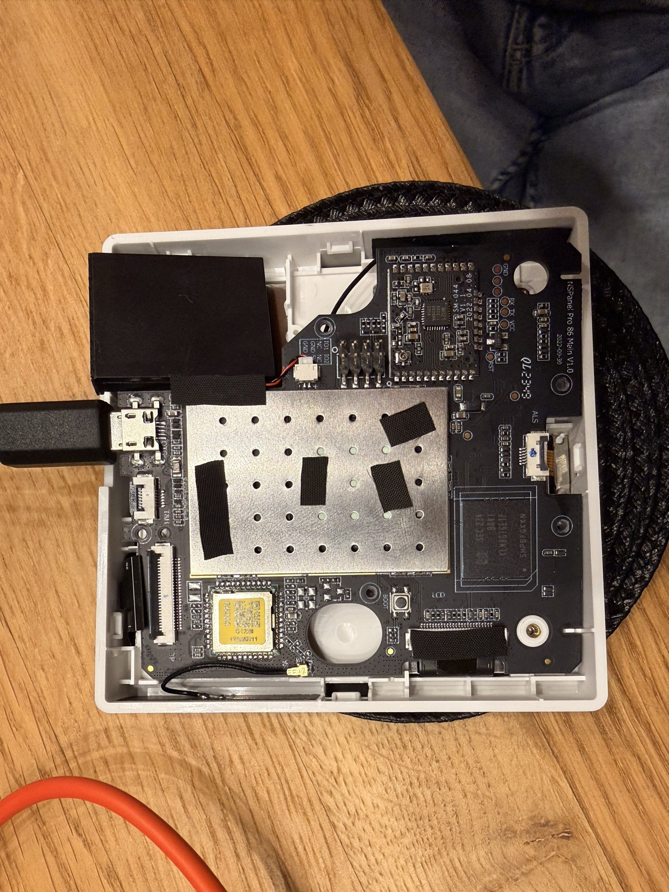
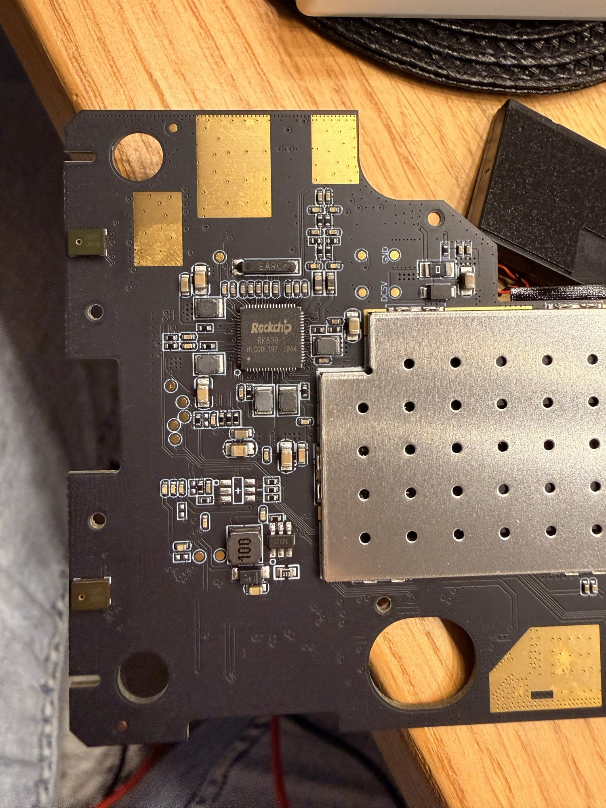
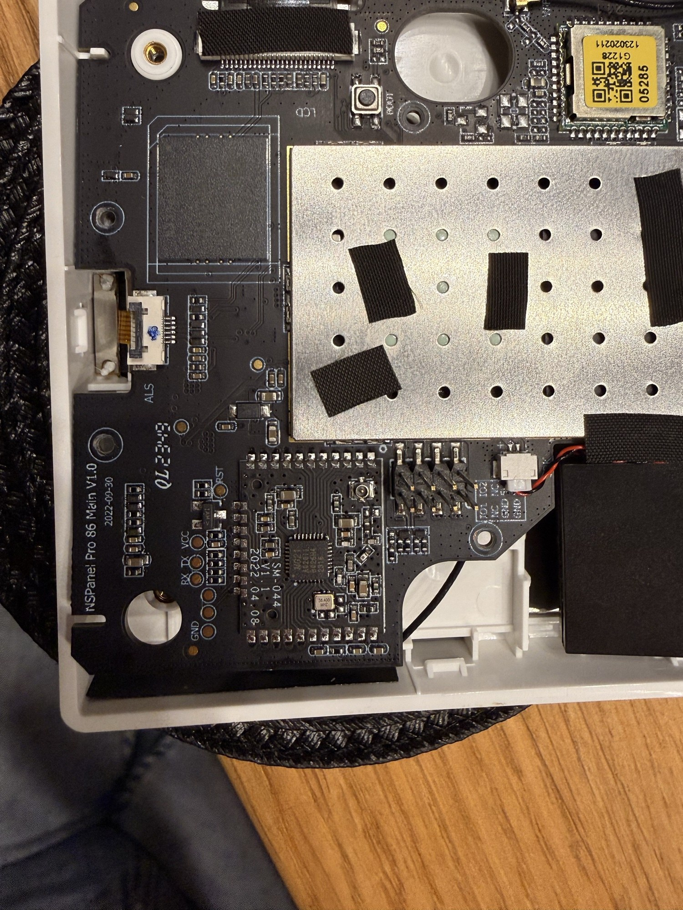
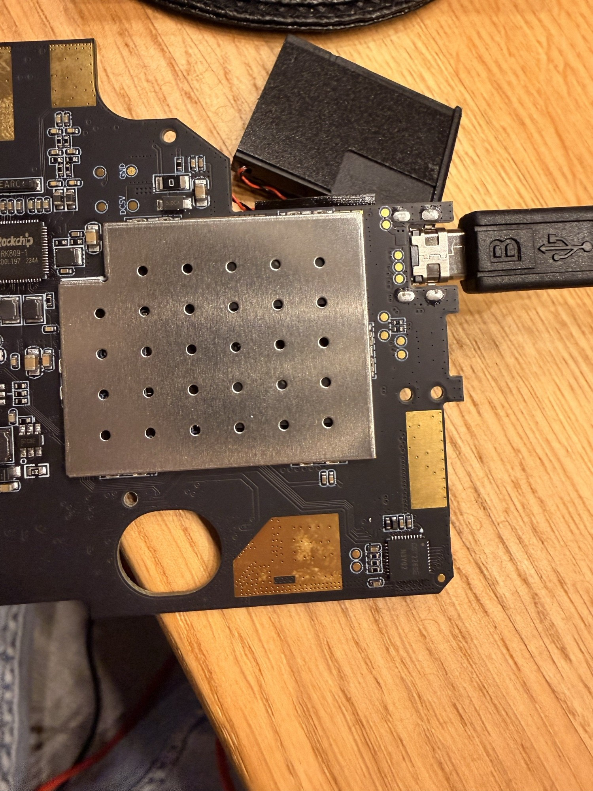
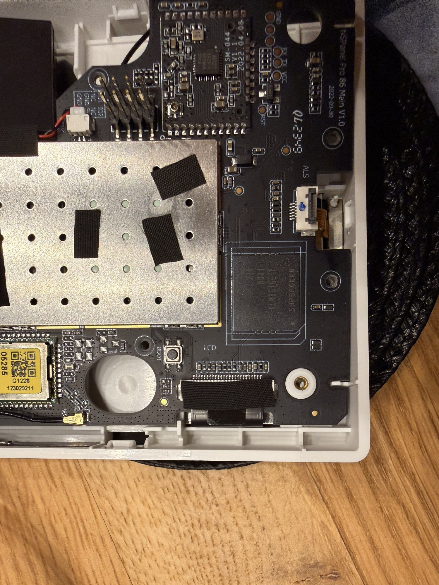
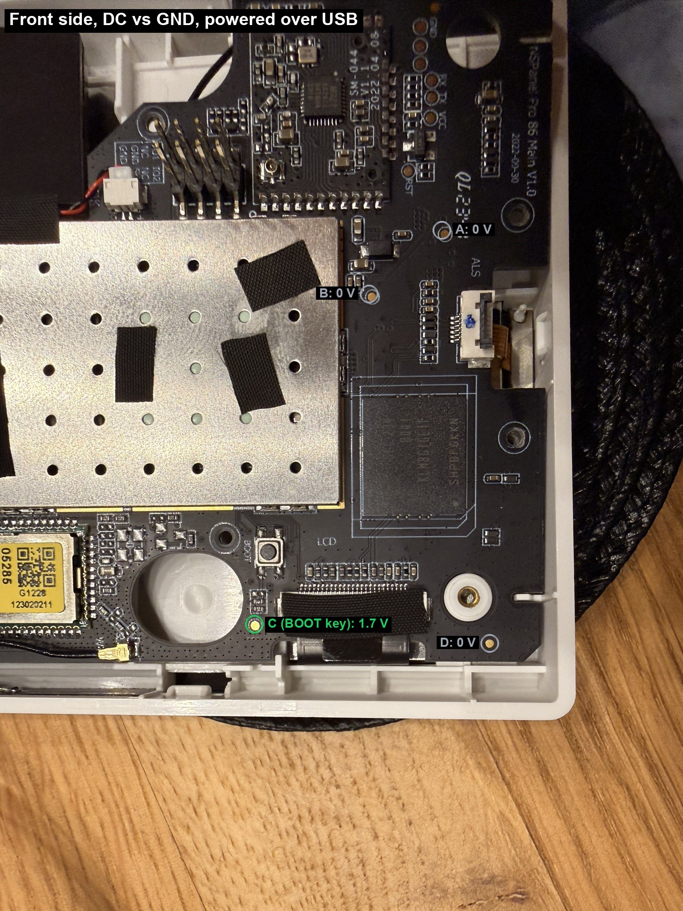
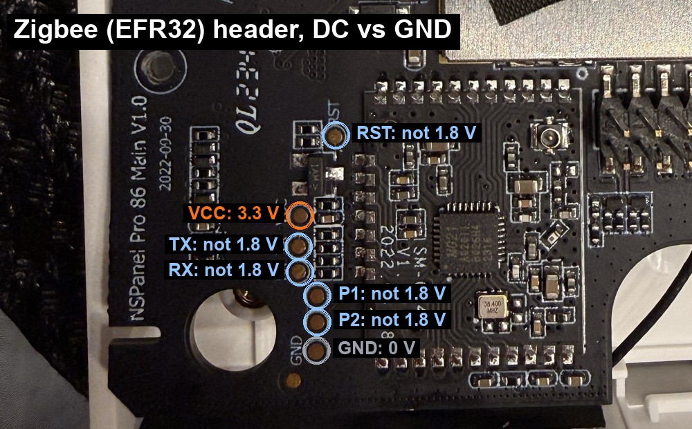
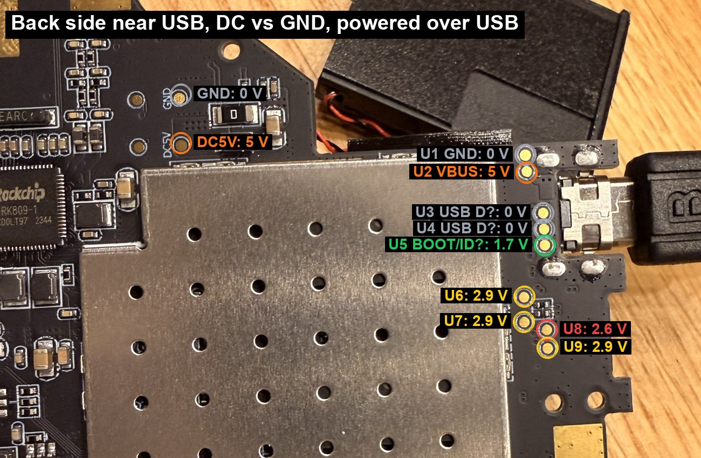
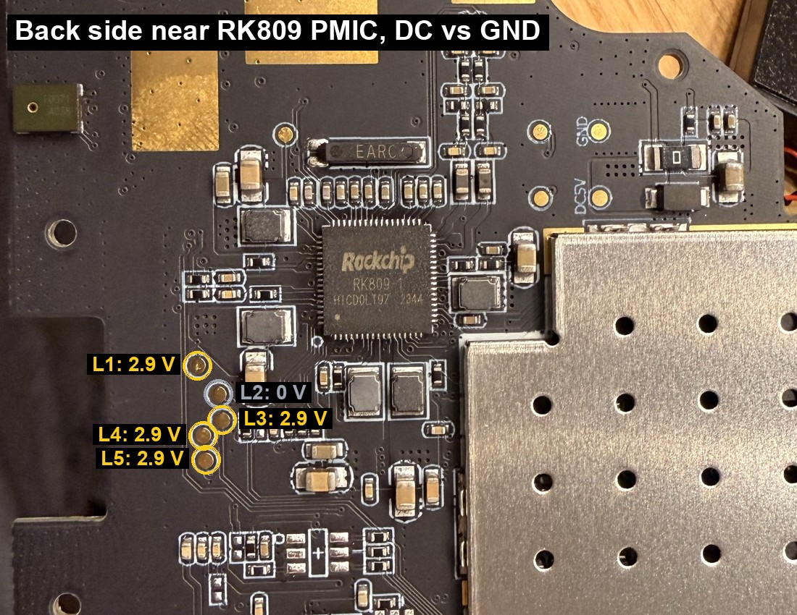

# NSPanel Pro 86 Main V1.0 – board notes and test points

All voltages are DC, measured against GND with a multimeter while the board was powered from the micro-USB port. At the time of measurement the panel was stuck booting our test image (see the [incident report](incident-2026-11-11-recovery-boot.md)), so U-Boot and possibly our kernel were running.

## Photos

| Front (component side) | Back (display side) |
|---|---|
|  |  |
|  |  |
|  | |

## Front side

| Pad | Location | Voltage | Interpretation |
|---|---|---|---|
| A | next to the "QL2349" silkscreen, above the Zigbee module | 0 V | unknown; shorting it to GND did **not** trigger MaskROM |
| B | near the shield corner, next to a diode and two capacitors | 0 V | unknown, looks like a power circuit area, do not short |
| C | just below the BOOT button | 1.7 V | BOOT key / SARADC line |
| D | bottom-right corner next to the screw | 0 V | unknown |

The small gold dots along the eMMC package edge are package solder, not test points.

### Zigbee module header

`RST`, `VCC`, `TX`, `RX`, two unlabeled pads and `GND` next to the `SM-044` module. `VCC` is 3.3 V and none of the other pads is at 1.8 V. This is the EFR32 module's own header (UART, reset, programming), not the SoC console.

## Back side

### Near the micro-USB connector

| Pad | Voltage | Interpretation |
|---|---|---|
| U1 | 0 V | GND |
| U2 | 5 V | VBUS |
| U3 | 0 V | USB D+ or D− (0 V means no device pull-up, the panel is not presenting itself on USB) |
| U4 | 0 V | USB D− or D+ |
| U5 | 1.7 V | BOOT key line or USB ID |
| U6 | 2.9 V | signal, idle high |
| U7 | 2.9 V | signal, idle high |
| U8 | 2.6 V | signal, idle high, lower average (possibly active traffic) |
| U9 | 2.9 V | signal, idle high |
| GND (labeled) | 0 V | ground |
| DC5V (labeled) | 5 V | 5 V input from the wall base |

U1–U5 match the "GND / VCC / DM / DP / UBOOT" group that The Roboverse documented on the 120 board. U6–U9 are the best candidates for the SoC debug UART (UART2). The lower average on U8 suggests a TX line with traffic. They could also be I2C lines; listening with a USB-UART adapter will tell.

The logic level of these pads is about 3 V. The Roboverse reports a 1.8 V console on the 120 board, but on this 86 board a 3.3 V adapter is the right choice.

### Near the RK809 PMIC

| Pad | Voltage |
|---|---|
| L1 | 2.9 V |
| L2 | 0 V |
| L3 | 2.9 V |
| L4 | 2.9 V |
| L5 | 2.9 V |

## MaskROM

No accessible pad sits at 1.8 V, so no eMMC data, command or clock line is exposed on either side outside the shields. MaskROM via a test point is not possible on this board without going under a shield. The 120 board has a documented D0 pad next to the ALS connector; the 86 board does not have it in the same place.

## Debug console

- UART2, `uart2m0` (GPIO1_D2 TX, GPIO1_D3 RX per the vendor DTS), 1 500 000 baud 8N1.
- Candidate pads: U6–U9 on the back side, about 3 V logic.
- Adapter requirements: 3.3 V, must support 1 500 000 baud (CH340, CH343 or FTDI; the original CP2102 tops out at 1 Mbaud).
- Connect only GND and the adapter RX first (listen only), never the adapter's VCC.
