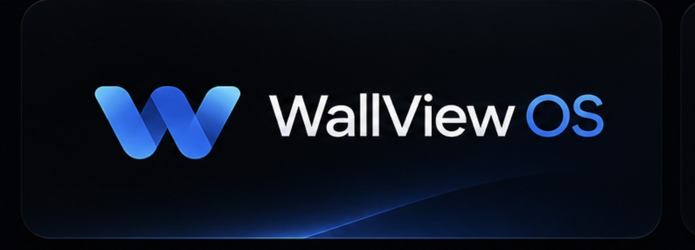
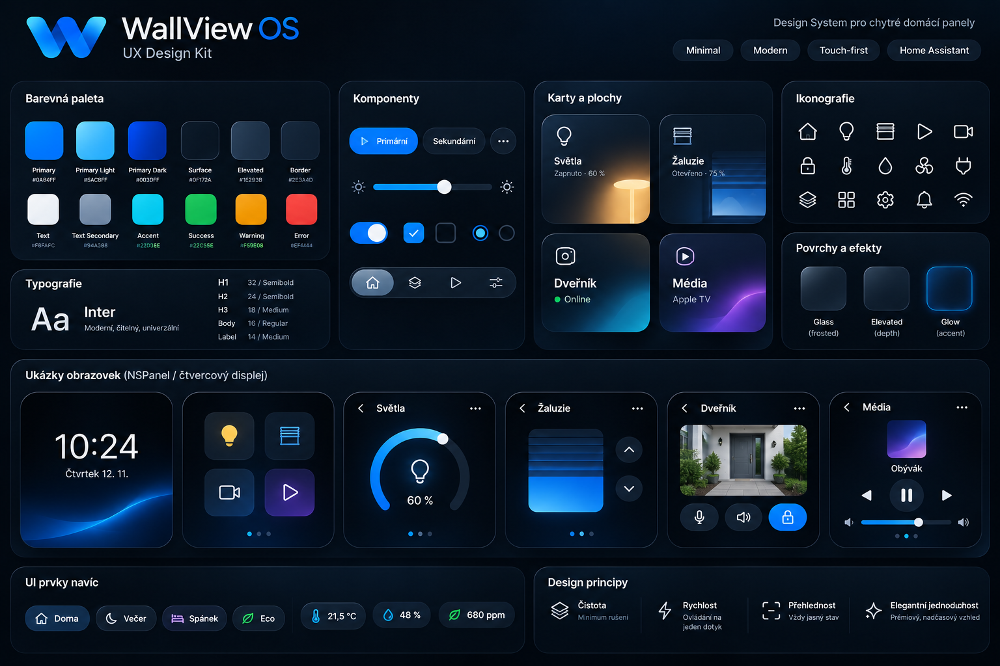
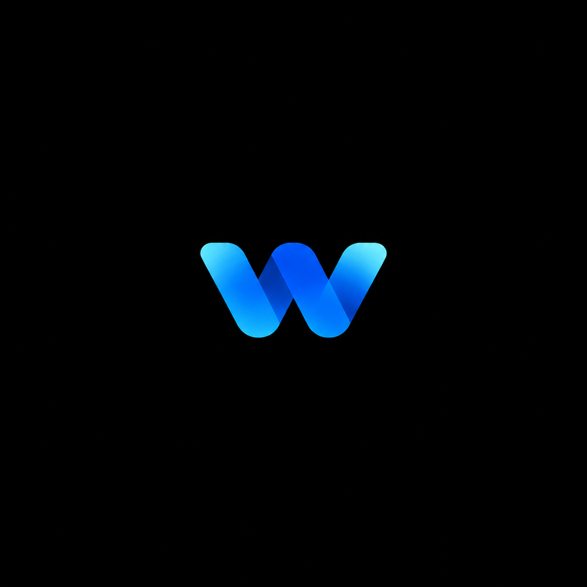
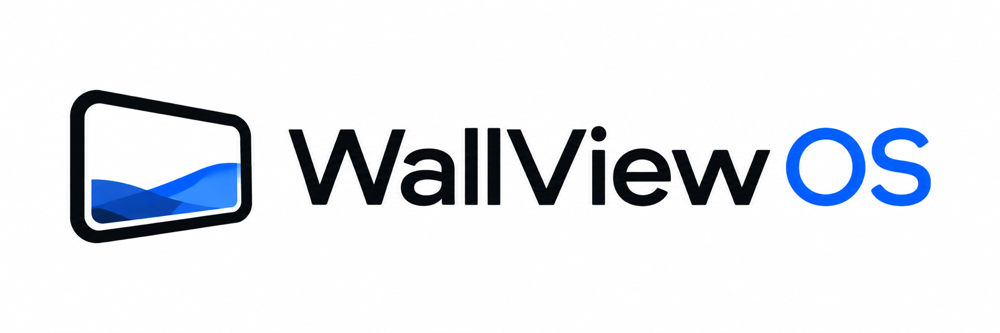
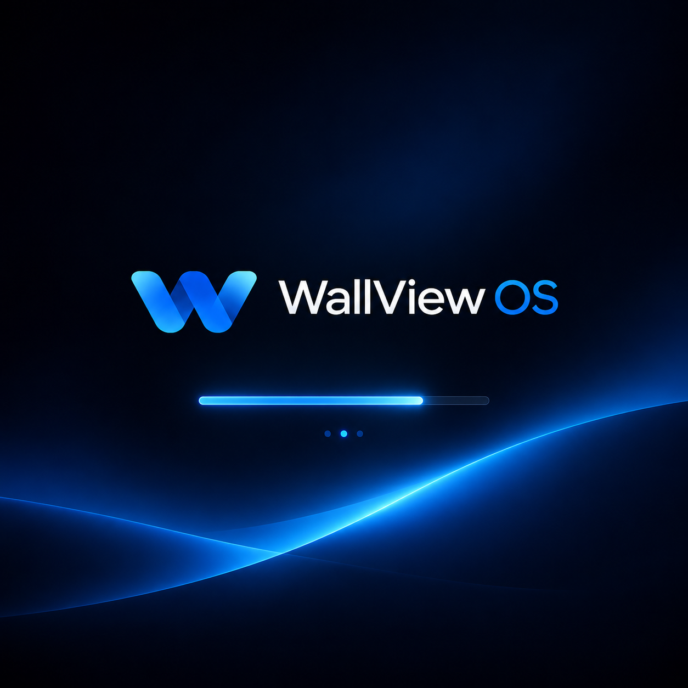

# WallView OS – design

Design system for smart home wall panels: minimal, modern, touch-first.

## Design kit

## Logo

The approved WallView OS logo is a blue "W" made of overlapping bands.

The vector logo is four bands (two down-strokes in front, the dark up-stroke behind them, the right up-stroke under the middle band) with flat rounded tops and round bottoms. `tools/logo/make-logo.py <dir>` generates it from the band geometry and two palettes: `logo.svg` (the approved colours), `logo-alt.svg` (the same bands shifted towards turquoise and indigo) and `logo-glow.svg` (the logo blurred, with a margin for the blur). The kiosk files in `buildroot/board/wallview/rootfs-overlay/usr/share/wallview/` are its output.

The Home Assistant logo is not used anywhere in the WallView UI or firmware; a home icon or the WallView logo is used instead.

Rejected earlier concept (frame with a wave), kept for history only:

## Boot screen

Static logo from U-Boot and the kernel, then an animated logo in Cog, then a crossfade to the dashboard (see the plan, phase 4).

Animation (chosen 2026-11-27, "breathing"): the logo stands still while a blurred copy of it and a wide blue halo behind it breathe in and out (opacity 0.1 to 0.9, period 3.2 s), and the bands slowly cross-fade into the alternative palette and back (opacity up to 0.7, period 6.4 s). Only opacity changes, so every layer is painted once and the compositor only blends. The frames are locked to 60 fps (Jakub, 2026-11-27): each keyframe interval is 0.1 s (breathing) or 0.2 s (colours) with `steps(6)` or `steps(12)`, so a value changes exactly every 16.7 ms, once per display refresh at 60 Hz; 30 fps would be `steps(3)` and `steps(6)`.

## Colour tokens

| Token | Hex |
|---|---|
| Primary | `#0A84FF` |
| Primary Light | `#5AC8FF` |
| Primary Dark | `#003DFF` |
| Surface | `#0F172A` |
| Elevated | `#1E293B` |
| Border | `#2E3A4D` |
| Text | `#F8FAFC` |
| Text Secondary | `#94A3B8` |
| Accent | `#22D3EE` |
| Success | `#22C55E` |
| Warning | `#F59E0B` |
| Error | `#EF4444` |

## Typography

Font: Inter (OFL), bundled locally.

| Style | Size / weight |
|---|---|
| H1 | 32 / Semibold |
| H2 | 24 / Semibold |
| H3 | 18 / Medium |
| Body | 16 / Regular |
| Label | 14 / Medium |

## Surfaces and effects

- Glass (frosted): static pre-blurred background with translucent cards, no live `backdrop-filter`
- Elevated (depth)
- Glow (accent), used sparingly

## Components

Primary and secondary buttons, icon button, brightness slider, toggle, checkbox, radio, bottom navigation bar, status chips (Home, Evening, Sleep, Eco), sensor chips (temperature, humidity, CO₂).

## Cards and tiles

Lights, blinds, door intercom, media. Example screens for the square 480×480 NSPanel display: clock, tile grid, lights with circular dimmer, blinds with large up/down buttons, door intercom with microphone, speaker and unlock, media player.

## Principles

| Principle | Meaning |
|---|---|
| Clarity | minimum distraction |
| Speed | one-tap control |
| Overview | state is always clear |
| Elegant simplicity | premium, timeless look |
