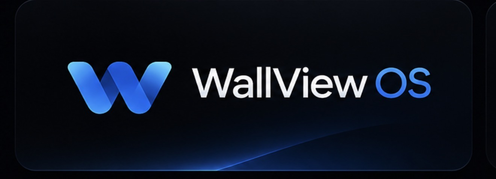
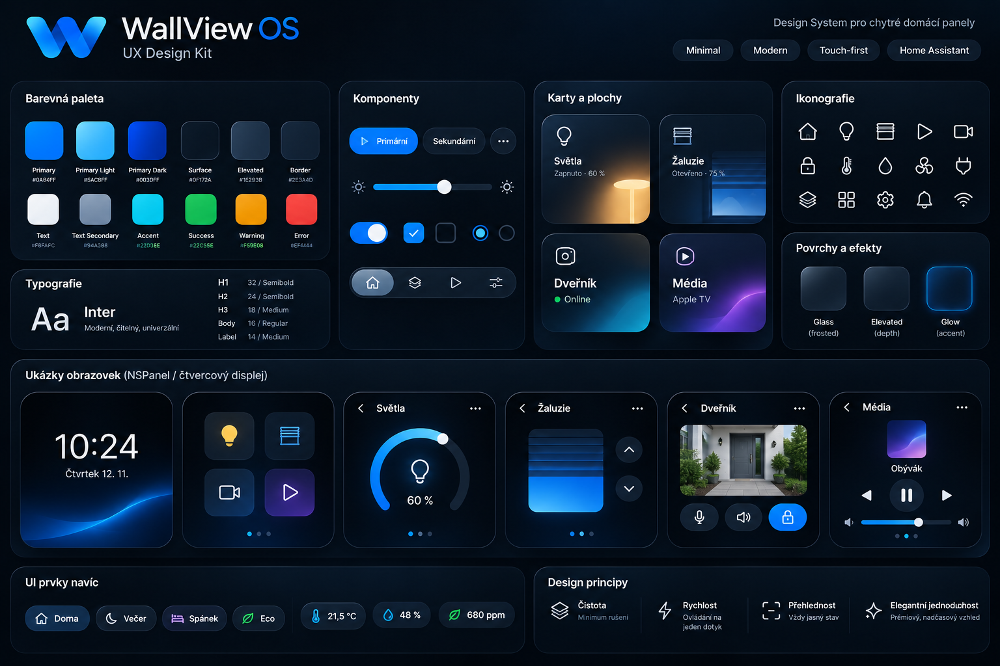
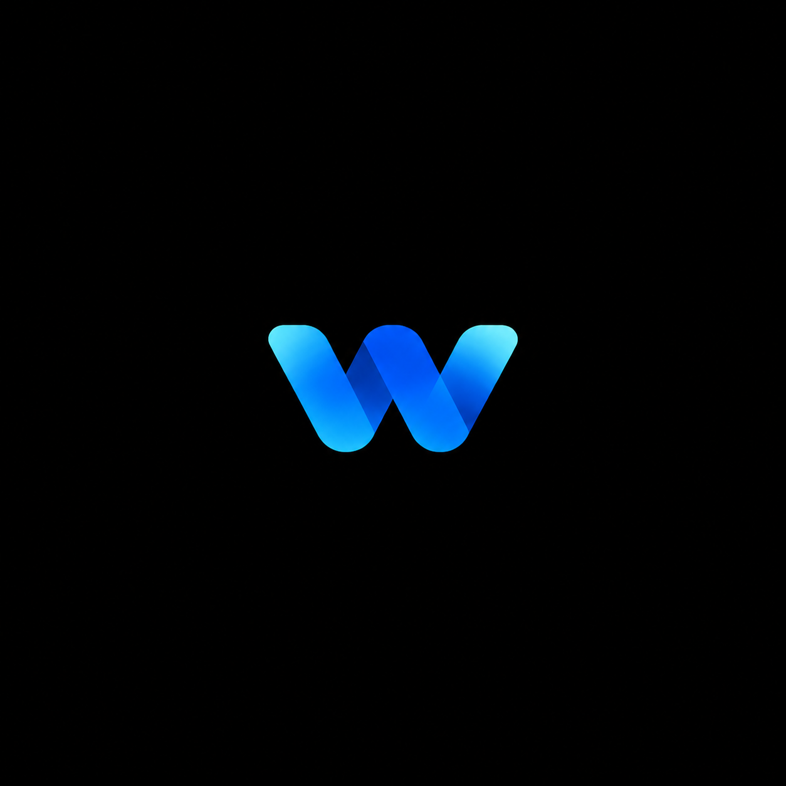
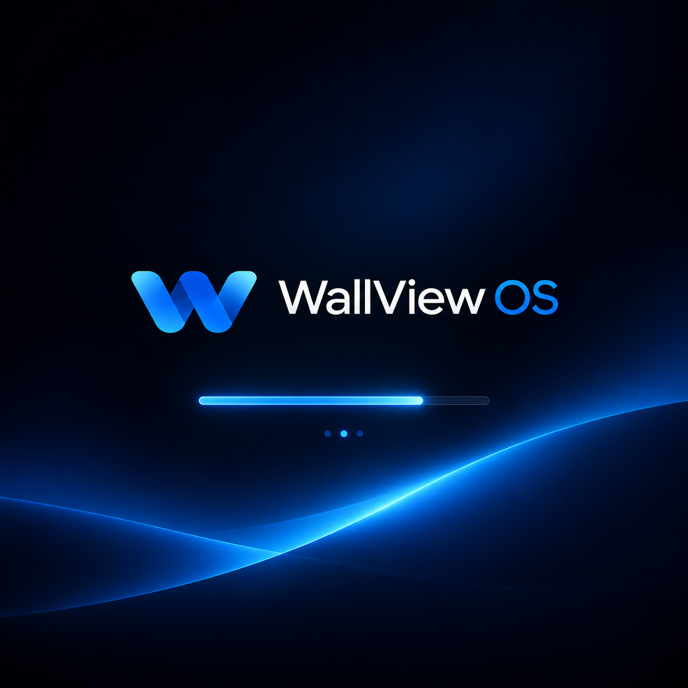

# WallView OS – design

Design system for smart home wall panels: minimal, modern, touch-first.

## Design kit

## Logo

The approved WallView OS logo is a blue "W" made of overlapping bands.

The Home Assistant logo is not used anywhere in the WallView UI or firmware; a home icon or the WallView logo is used instead.

## Boot screen

Static logo from U-Boot and the kernel, then an animated logo in Cog, then a crossfade to the dashboard (see the plan, phase 4).

## Colour tokens

| Token | Hex |
|---|---|
| Primary | `#0A84FF` |
| Primary Light | `#5AC8FF` |
| Primary Dark | `#003DFF` |
| Surface | `#0F172A` |
| Elevated | `#1E293B` |
| Border | `#2E3A4D` |
| Text | `#F8FAFC` |
| Text Secondary | `#94A3B8` |
| Accent | `#22D3EE` |
| Success | `#22C55E` |
| Warning | `#F59E0B` |
| Error | `#EF4444` |

## Typography

Font: Inter (OFL), bundled locally.

| Style | Size / weight |
|---|---|
| H1 | 32 / Semibold |
| H2 | 24 / Semibold |
| H3 | 18 / Medium |
| Body | 16 / Regular |
| Label | 14 / Medium |

## Surfaces and effects

- Glass (frosted): static pre-blurred background with translucent cards, no live `backdrop-filter`
- Elevated (depth)
- Glow (accent), used sparingly

## Components

Primary and secondary buttons, icon button, brightness slider, toggle, checkbox, radio, bottom navigation bar, status chips (Home, Evening, Sleep, Eco), sensor chips (temperature, humidity, CO₂).

## Cards and tiles

Lights, blinds, door intercom, media. Example screens for the square 480×480 NSPanel display: clock, tile grid, lights with circular dimmer, blinds with large up/down buttons, door intercom with microphone, speaker and unlock, media player.

## Principles

| Principle | Meaning |
|---|---|
| Clarity | minimum distraction |
| Speed | one-tap control |
| Overview | state is always clear |
| Elegant simplicity | premium, timeless look |
